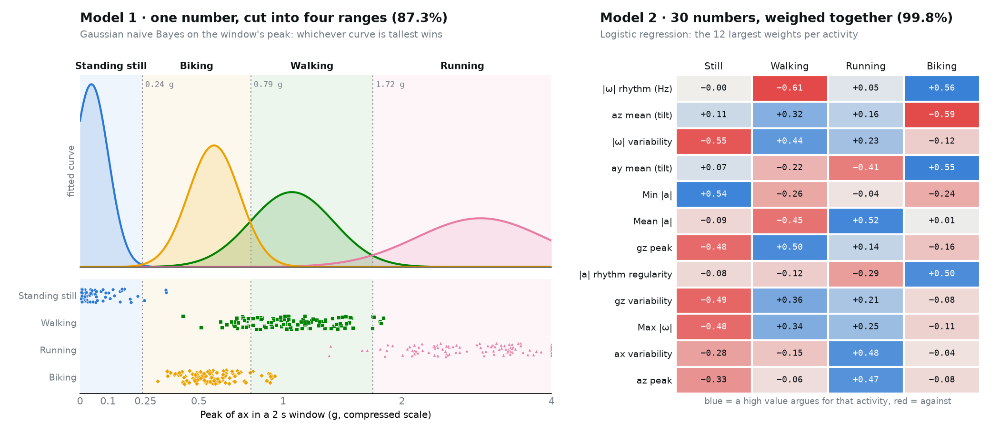

# GaitID

## Introduction

The touchstone for this project was the way a fitness watch quietly notices that you have started a run without ever being told, and I wanted to find out how much of that trick I could rebuild with one motion sensor strapped to my ankle. Specifically, GaitID pairs an MPU-6050 six-axis IMU (three axes of acceleration and three of rotation) with an Arduino UNO Q, samples it 50 times a second, and sorts every 2-second slice of motion into one of four activities: standing still, walking, running, or biking. The real question was not only whether it could tell those apart, but also how much it mattered what the model was allowed to see, so I built two models and pitted them against each other: one that only gets a single number (the hardest jolt along one axis) and one that gets everything the sensor reports. This was not a major success at first, since my first round of training came back at a whopping 0% (the sensor had been asleep the entire time, and I had painstakingly recorded eight minutes of perfect zeros), but after teaching the board to wake the sensor back up whenever it reads nothing, the full model now classifies my movement with 99.8% cross-validated accuracy, and a stick-figure demo walks a whole group through it one groupmate at a time.

## Demonstration video

[Watch the demo run (media/demo.mp4)](media/demo.mp4)

In order to show the whole experience without strapping the sensor to anyone, I wrote [tools/record_demo.py](tools/record_demo.py), which drives the exact same window as the live demo in [tools/demo.py](tools/demo.py) through a scripted run and saves every frame to a 1 minute 54 second video. The run goes the same way it does in person:

1. Standing still: the stick figure stands with "You are standing still" under it while the first groupmate gets ready.
2. Walking: the figure breaks into a walking animation and a green bar fills over 30 seconds of walking.
   1. Hand-off card: "Say 'Wow, that was cool!'", then pass the device to the next groupmate.
3. Running: a faster stride with bent arms and a forward lean, again for 30 seconds.
   1. Hand-off card, with biking up next.
4. Biking: the figure hops on a bike and pedals for 30 seconds, wheels spinning and the ground scrolling past.
   1. Final card: everyone has had a turn, and Space starts the whole thing over.

Of note, the activities in this recording are scripted rather than detected (the small gray line at the bottom of the frame says as much), since the point is to show the interface. In the live version the figure only changes once three predictions in a row agree, which costs about four seconds of lag but keeps one odd step from flipping the answer, and the 30-second bar only fills while the model actually sees the activity it is waiting for.

## Graphical representation of the models

The left half is Model 1's entire decision process. Each curve is the Gaussian fit to one activity's peak values. The shaded bands mark which activity wins at each peak. The dots below are all 440 training windows, one row per activity. The weak spot is easy to find: walking and biking overlap across the 0.79g threshold, and every walking window left of that line gets labeled biking.

The right half shows Model 2's 12 largest weights. Blue means a high value of that feature argues for an activity, and red means it argues against. Reading down a column gives the model's picture of each activity. Biking, for example, is a fast, regular |ω| rhythm with the shin tilted differently than in walking. [tools/plot_models.py](tools/plot_models.py) rebuilds the figure from whatever [tools/train.py](tools/train.py) last saved. An interactive version with confusion matrices and example decisions lives on the explainer page.

## Model 1: one number

Model 1 reduces each 2s window to one number: the largest deviation from the median along a single accelerometer axis (`peak_feature` in [gaitid/features.py](gaitid/features.py)). Subtracting the median removes gravity and strap tilt. What remains is roughly how hard the ankle got jolted. To pick the axis, [tools/train.py](tools/train.py) cross-validates all three and keeps the best one. That was x at 87%, with y and z trailing at 69% and 66%.

The classifier is Gaussian naive Bayes. It fits one Gaussian per activity to the peak values, weighted by how common that activity is. A new window goes to whichever curve is tallest at its peak. With a single input, this collapses into four ranges on a ruler. Standing still wins below 0.24g, biking from 0.24 to 0.79g, walking from 0.79 to 1.72g, and running above that.

I like that the whole model fits on one chart. Unfortunately, pedaling jolts the ankle about as much as a gentle step does. That puts biking between standing and walking, and the model has no second feature to separate them. To score it, I used grouped cross-validation, which holds out whole recordings. Model 1 landed at 87.3%, and it labeled 24 of the 110 walking windows as biking.

## Model 2: everything the sensor says

Model 2 describes the same window with 30 features. The first 18 are the mean, standard deviation, and peak of each of the six IMU axes. The other 12 come from |a| and |ω|, which don't depend on how the strap is turned. They include the dominant frequency between 0.5 and 6Hz and the share of motion at that frequency.

The classifier is multinomial logistic regression on standardized features. Each activity gets one weight per feature, and a softmax turns the four scores into probabilities. Inference is plain numpy in [gaitid/model.py](gaitid/model.py), so the same model also runs on the UNO Q's Linux side.

Under the same cross-validation, Model 2 got 439 of 440 windows right (99.8%). The lone miss was a running window labeled walking.

To find where that margin comes from, I retrained Model 2 with parts of its input removed. Dropping the three axis means, which mostly encode tilt, only lowered it to 99.5%. The mean, standard deviation, and peak of the x axis alone reached 99.3%. The gain isn't coming from the extra sensors. It comes from summarizing the window better, since a peak is one sample out of 100 and a standard deviation uses all of them.

Of note, the dataset is small: two 60s takes per activity, all of me, recorded in one session with the sensor on my ankle. I expect these numbers to drop once other groupmates and a hip mount get involved.
