# GaitID Step Counter: StepNet, End to End

The prompt for this part of ME193 was short: "Your goal here is to extend your walker to now count your steps using a neural net and PyTorch. Use every sensor you can to make it as accurate as possible." My walker already ran on an Arduino UNO Q with an MPU-6050 on my right ankle, and it could tell standing, walking, running and biking apart. To use every sensor I had, I strapped a LEGO Education Double Motor to my left ankle for its built-in IMU. The neural net, StepNet, is a 70,657-weight convolutional network trained in PyTorch. On my first real walk to class it counted about 1,096 steps with nothing but the board on my leg.

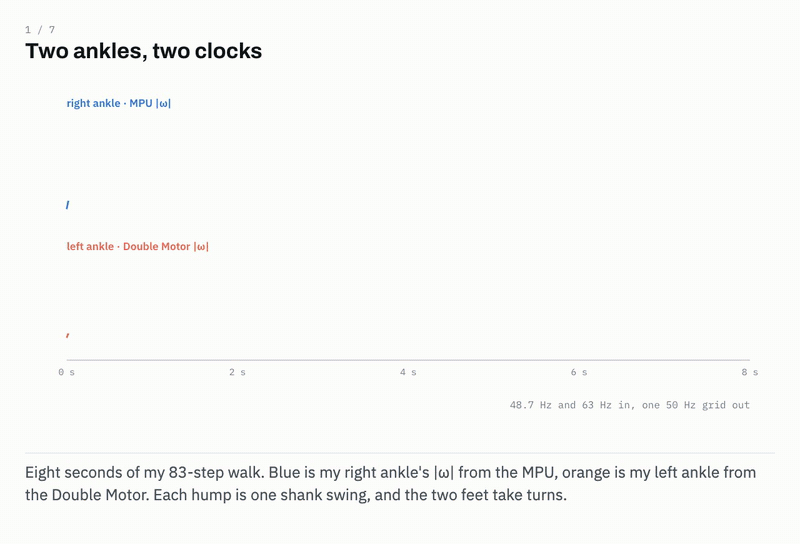

▶ Full-quality video: `media/stepnet-animation-full.mp4`

---

## The hardware

The MPU-6050 sits on the UNO Q's header SDA/SCL pins at I2C address 0x68, set to ±8g and ±1000°/s. Bringing it up took longer than the neural net did. My first sketch read the Qwiic bus (`Wire1`) while the sensor was wired to the header (`Wire`), so the board saw nothing. After fixing the bus, the first dataset came back as a lovely set of zeroes. The MPU-6050 powers up asleep, and a loose jumper had reset it after the sketch had already sent the wake command. I forced the sketch to resend the wake command on any all-zero read in [sketch.ino](https://github.com/Lucalo44/ME193-Code/blob/main/GaitID/app/sketch/sketch.ino).

The Double Motor talks Bluetooth Low Energy through the `legoeducation` library. I set its notifications to 15ms, the fastest it allows, and measured 63Hz in practice. The samples arrive in bursts, so [sources.py](https://github.com/Lucalo44/ME193-Code/blob/main/GaitID/stepcount/sources.py) re-spaces them onto an even clock. One IMU per ankle is deliberate. An ankle sensor sees its own heel strike clearly and the other foot only as a faint echo.

The same hardware runs in three arrangements:

1. **Walking, no laptop.** The STM32 samples the MPU at 50Hz. The Linux side logs every row and runs a numpy copy of StepNet. The count goes back over the Bridge to the LED matrix.
   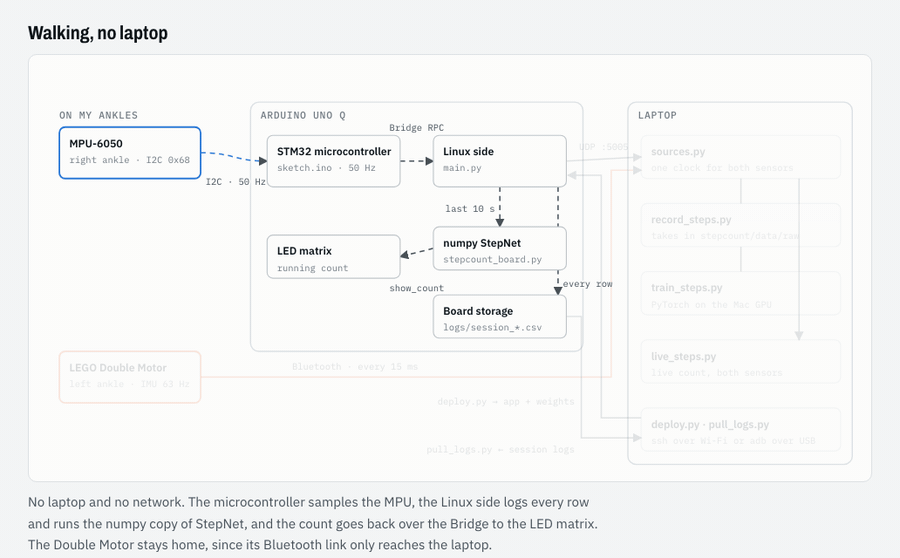
2. **Syncing.** Over Wi-Fi or USB, [deploy.py](https://github.com/Lucalo44/ME193-Code/blob/main/ArduinoUNOq/tools/deploy.py) pushes the app and the trained weights. [pull_logs.py](https://github.com/Lucalo44/ME193-Code/blob/main/GaitID/stepcount/tools/pull_logs.py) brings the session logs home.
   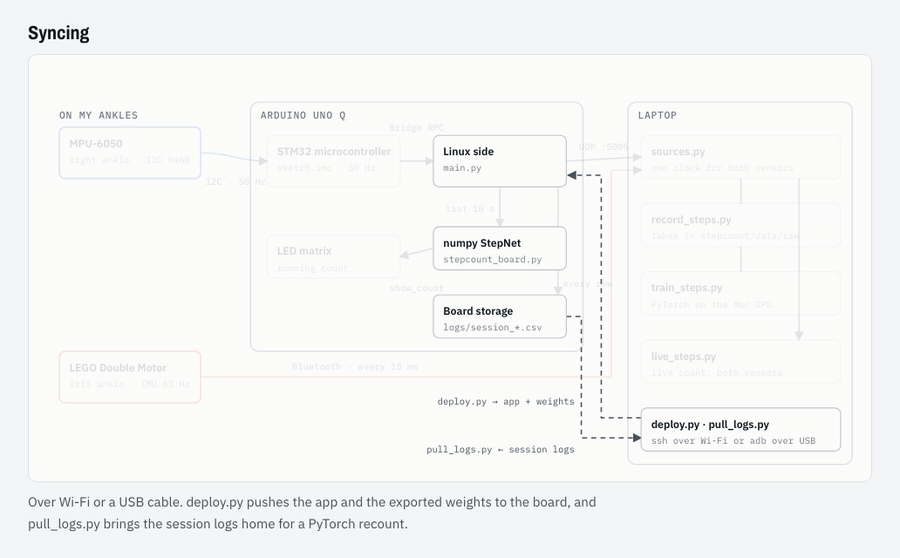
3. **Recording and training.** The UNO Q forwards the MPU over UDP port 5005, and the Double Motor streams Bluetooth straight to the laptop. Both land on one clock, and PyTorch trains on the labelled takes.
   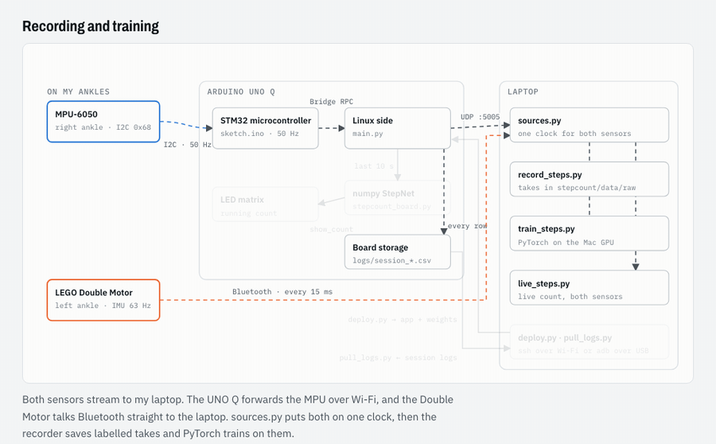

▶ All three modes in one video: `media/devices-all-modes.mp4`

---

## How PyTorch reads the sensors

Each take is two CSVs in physical units. These are the first rows of my 83-step walk.

`mpu.csv` (right ankle, 48.7Hz):

```
t,ax,ay,az,gx,gy,gz
0.00632,0.42800,0.15300,-1.01600,16.40000,-10.09000,8.32000
0.02532,0.44400,0.16900,-1.02600,18.02000,-8.75000,8.14000
0.04632,0.41900,0.14700,-1.03000,17.16000,-7.20000,11.28000
0.06632,0.40100,0.09600,-1.01800,17.62000,-6.01000,8.69000
```

`lego.csv` (left ankle, 63Hz):

```
t,ax,ay,az,gx,gy,gz,pitch,roll
0.00718,-0.96100,0.15500,-0.22900,4.00000,7.00000,-17.00000,72.80000,151.40000
0.02301,-0.94600,0.13100,-0.24400,3.00000,7.00000,-17.00000,72.90000,152.40000
0.03899,-0.95200,0.11600,-0.24800,3.00000,8.00000,-17.00000,72.90000,153.40000
0.05482,-0.95100,0.09200,-0.25500,2.00000,8.00000,-17.00000,72.90000,154.40000
```

The two sensors tick at different rates on different clocks. The UNO Q stamps rows with board time, and the laptop shifts that by the fastest packet's delay. The Double Motor gets its even clock. Both are then interpolated onto one 50Hz grid in [fuse.py](https://github.com/Lucalo44/ME193-Code/blob/main/GaitID/stepcount/fuse.py). On real data the two ankles lined up within 20ms.

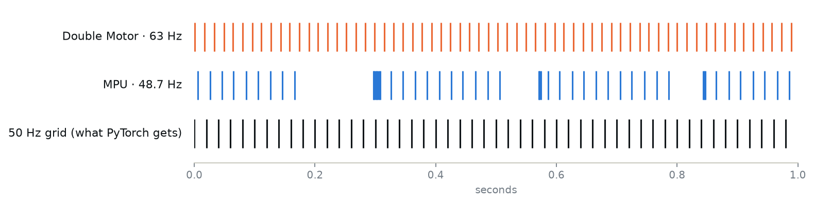

Each sample becomes 20 channels:

1. Per sensor: the accelerometer and gyro axes, |a|, |ω| and a present flag.
2. From the Double Motor only: pitch and roll. I left out yaw, since its zero is arbitrary and it drifts.
3. Accelerometer and tilt channels have their 1s running mean removed. That strips gravity and however the strap happens to sit.

Each accel and gyro triplet shares one normalization scale. Scaling per axis let a 20° strap rotation push 85°/s onto an axis with a 2°/s spread, which made a 40σ input. A training batch is a tensor of shape `(24, 20, 400)`: 24 crops, 20 channels, 400 samples (8s).

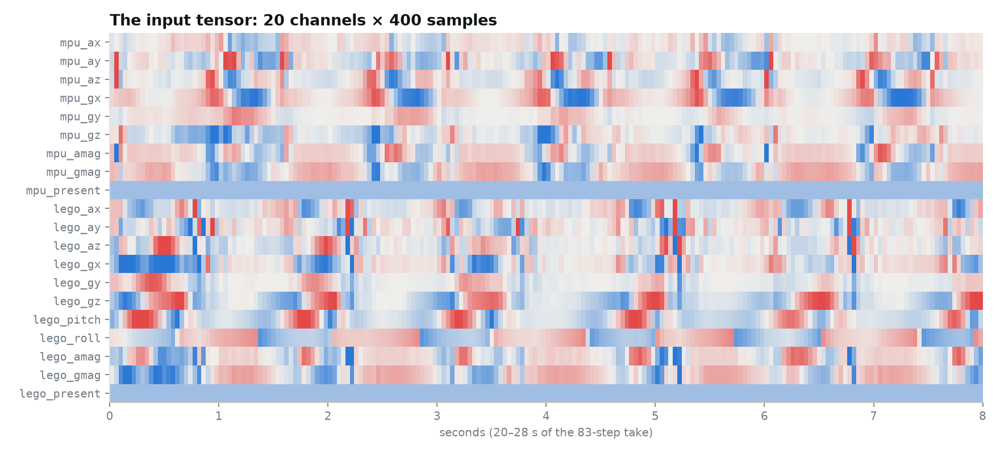

---

## Labels

Each take only stores the number of steps I counted out loud. Hand-timestamping every heel strike was not an option for 20 minutes of walking. My first labeller picked the N biggest spikes in |a|. This was not a major success. On real ankles the swing itself moves |a| by 0.5–0.9g, so it found 188 candidate peaks for 83 steps with no clear winners.

The gyro fixed it. Each stride, the shank swings forward and |ω| makes one hump of 300–500°/s. On the 83-step take the humps came out to 41 on the right ankle plus 42 on the left, exactly my count, alternating 98% of the time. [labels.py](https://github.com/Lucalo44/ME193-Code/blob/main/GaitID/stepcount/labels.py) keeps the N strongest humps and turns each one into a Gaussian bump of area 1. The target density then integrates to the step count.

---

## StepNet

StepNet lives in [net.py](https://github.com/Lucalo44/ME193-Code/blob/main/GaitID/stepcount/net.py). It is a temporal convolutional network with 70,657 weights:

1. A 1×1 convolution maps the 20 channels to 48.
2. Five residual blocks with kernel 5 and dilation 1, 2, 4, 8 and 16 follow. Each block sees twice as far as the last. The receptive field is 1 + 4 × 31 = 125 samples, or 2.5s, which covers about two strides.
3. A 1×1 convolution and a softplus give a step density for every 20ms sample.

The count over any stretch is the sum of the density. That means no thresholds and no peak picking. Overlapping windows also can't double count.

### Training

Training lives in [training.py](https://github.com/Lucalo44/ME193-Code/blob/main/GaitID/stepcount/training.py). Every batch is 24 random 8s crops. Each crop gets a strap rotation up to 20°, ±10% gain, up to ±60ms of clock skew between the sensors, and sensor dropout. A quarter of the crops lose the Double Motor and 15% lose the MPU. The dropout is why the board can count with the MPU alone. The loss is 100 × density error² plus 0.05 × count error². AdamW runs at a learning rate of 0.002 with cosine decay, for 40 batches per epoch.

To train fast, I moved it to the Mac's GPU. A batch took 200ms on the CPU and 11ms on MPS.

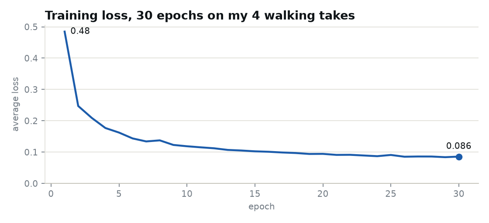

Three bugs were stacked on top of each other before the network learned anything:

1. The labels were wrong, as described above.
2. Per-axis normalization turned a tilted strap into 40σ inputs.
3. GroupNorm rescaled every crop until standing still looked like walking, and BatchNorm's statistics didn't match whole-take inference. StepNet now has no normalization layers.

To judge the network, I ran 4-fold cross-validation that holds out whole takes. On 16 synthetic takes, StepNet was off by 1.8% and a classic peak counter by 8.4%. Synthetic data only proves the code path, though, and the real takes are still all walking.

---

## From the laptop to the board

The board can't run PyTorch. [export_board.py](https://github.com/Lucalo44/ME193-Code/blob/main/GaitID/stepcount/tools/export_board.py) dumps the weights to a 285KB numpy file, and [board.py](https://github.com/Lucalo44/ME193-Code/blob/main/GaitID/stepcount/board.py) redoes the forward pass in plain numpy. It matches PyTorch to 1e-4. One 10s pass takes 62ms on the UNO Q.

In log mode, [main.py](https://github.com/Lucalo44/ME193-Code/blob/main/GaitID/app/python/main.py) writes every sample to a session CSV and rewrites a summary every 10s. Once a second it runs StepNet on the last 10s and commits the density 1.5s behind real time, each sample exactly once. The first deploy froze the microcontroller about 2.5s in. Calling `matrix.clear()` inside a draw hung the STM32, and only a power cycle released the I2C bus. I swapped it for a black rectangle and moved `Bridge.begin()` ahead of the sensor init.

---

## The walk to class

To test it for real, I wore the board and a power bank on my walk to class. The log ran 14.9 minutes at 50Hz. The board counted 1,140 live, and the laptop's PyTorch recount of the same samples gave 1,142. Cadence held at 118 steps/min for the first 7.5 minutes.

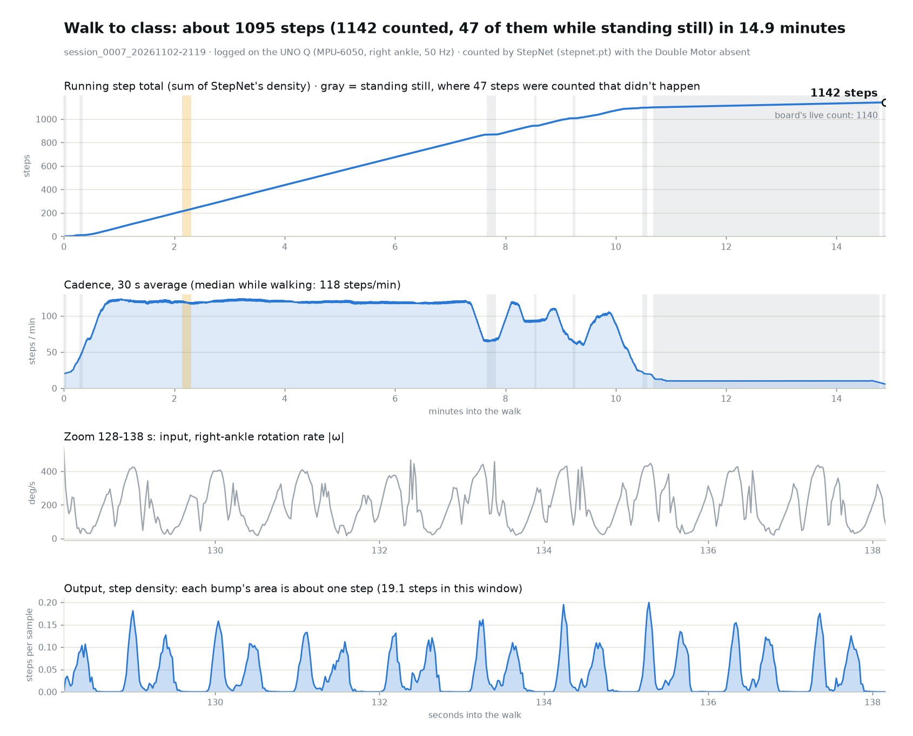

The total is a smidge high. For the last 4.6 minutes I was standing still, and the network kept adding 10 steps/min. It was trained only on walking, so it never learned zero. Those 47 phantom steps put the real count at about 1,096. I haven't verified that against a hand count yet.

---

## Summary flow

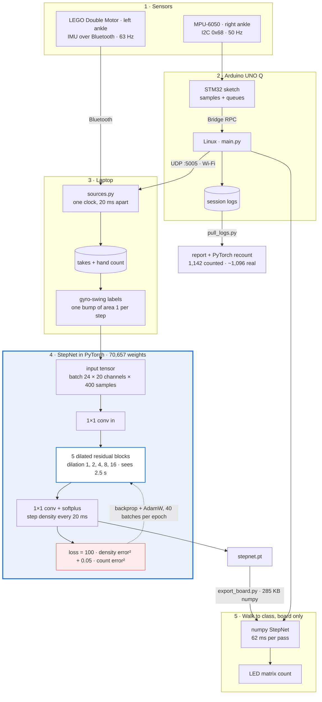

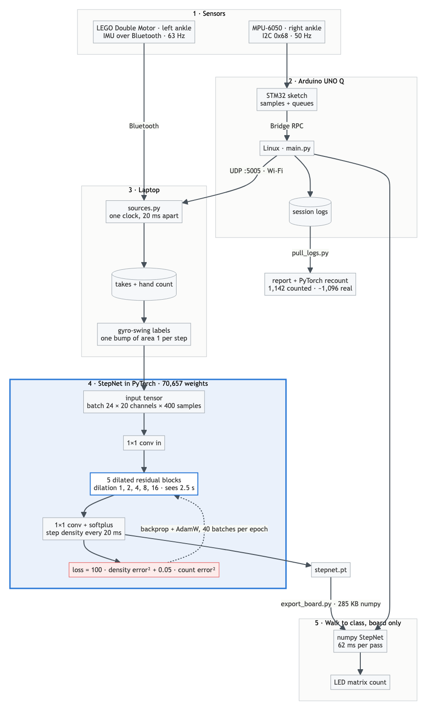

### The neural net, stage by stage

1. **Two ankles, two clocks.** Eight seconds of the 83-step walk from both IMUs. Each |ω| hump is one shank swing.
   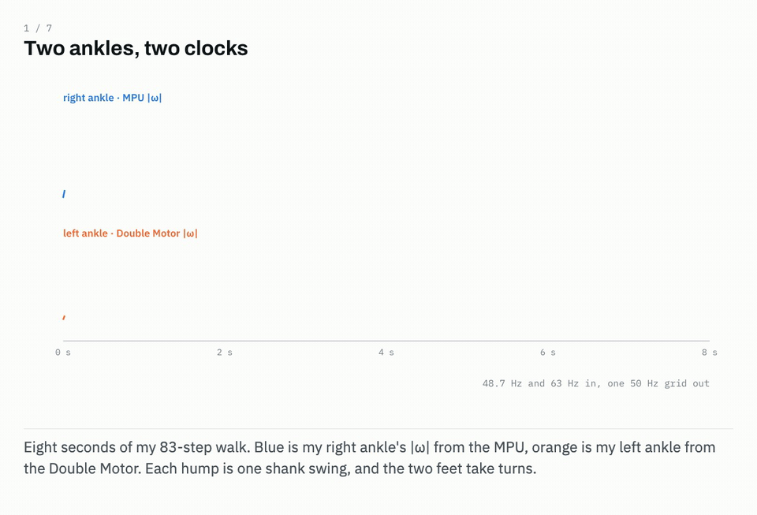
   ▶ `media/stepnet-1-raw-signals.mp4`
2. **Into a tensor.** The 20 aligned, scaled channels become a `1 × 20 × 400` tensor.
   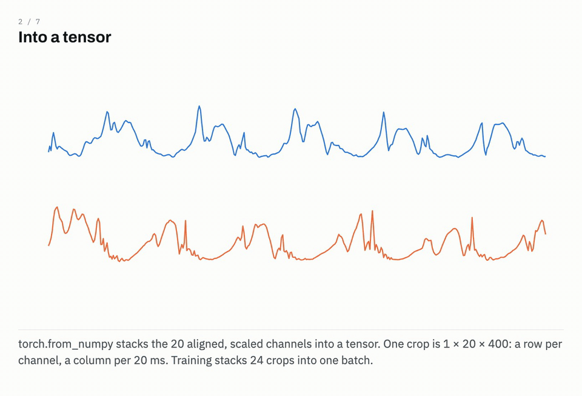
   ▶ `media/stepnet-2-into-a-tensor.mp4`
3. **The forward pass.** Five dilated blocks give each output sample a 125-sample (2.5s) view.
   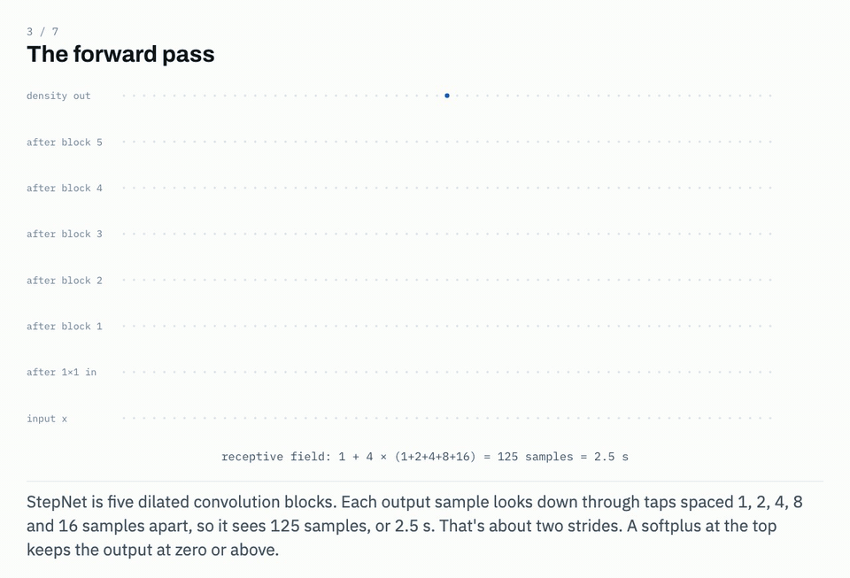
   ▶ `media/stepnet-3-forward-pass.mp4`
4. **Measuring the error.** The untrained network is a flat smear against one labelled bump per step.
   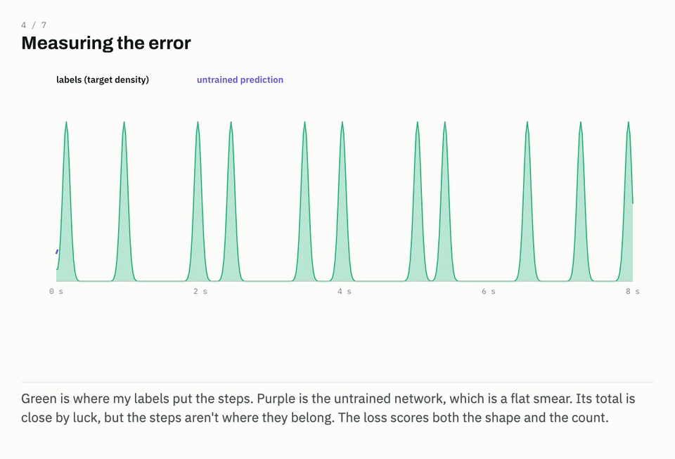
   ▶ `media/stepnet-4-loss.mp4`
5. **Backpropagation.** `loss.backward()` gives all 70,657 weights a gradient, and AdamW steps them.
   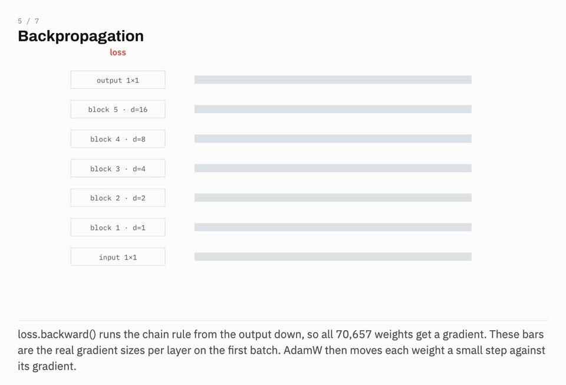
   ▶ `media/stepnet-5-backpropagation.mp4`
6. **Repeat.** Over 30 epochs the smear becomes one bump per step. The loss falls from 0.48 to 0.086, and the gradients shrink about 20×.
   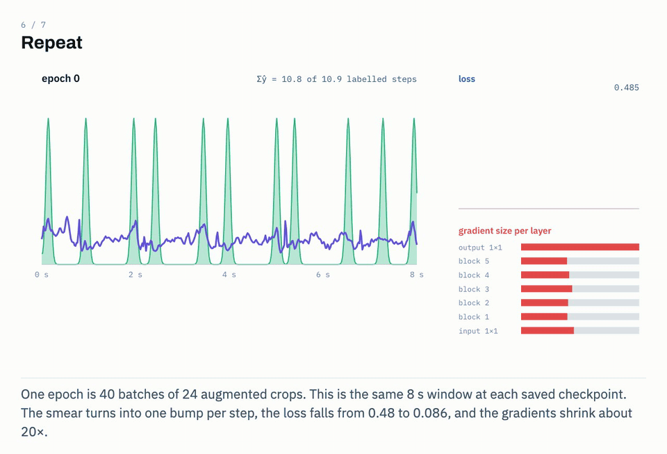
   ▶ `media/stepnet-6-training-epochs.mp4`
7. **Counting the walk.** The numpy copy on the board sums the density, giving 1,140 on the board and 1,142 on the laptop.
   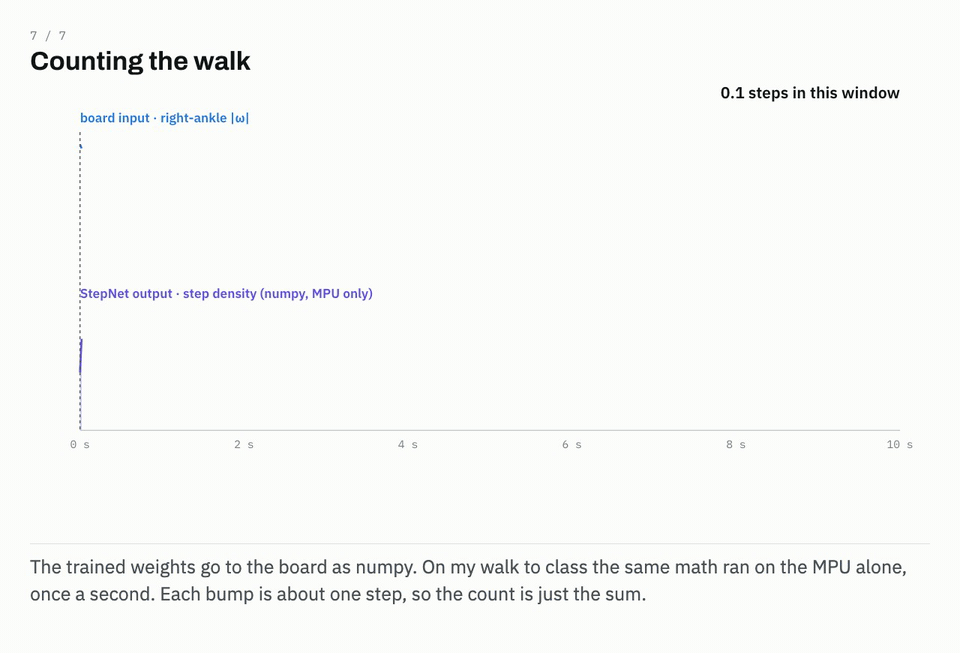
   ▶ `media/stepnet-7-counting-the-walk.mp4`

| Key number | Value |
|---|---|
| StepNet weights | 70,657 |
| Receptive field | 125 samples, 2.5s |
| Input batch | 24 × 20 × 400 |
| Sample rate | 50Hz (MPU 48.7Hz, Double Motor 63Hz before resampling) |
| Training data | 4 walking takes, 291 steps |
| Training loss | 0.48 → 0.086 over 30 epochs |
| Board inference | 62ms per 10s pass, numpy |
| Walk to class | 14.9 min, 1,142 counted, about 1,096 real |
